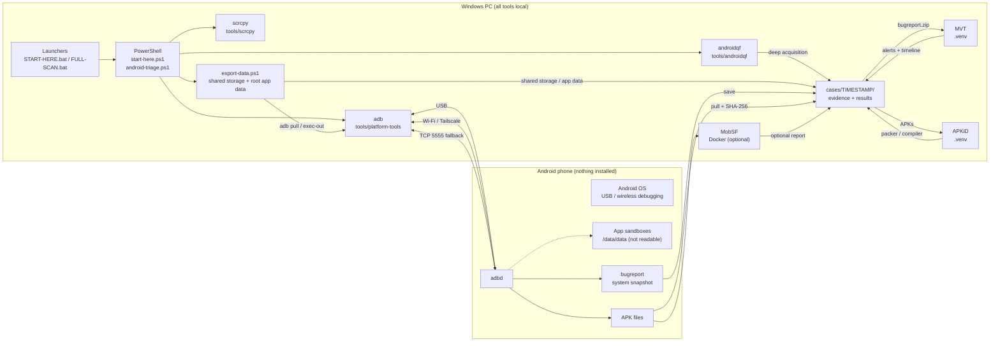
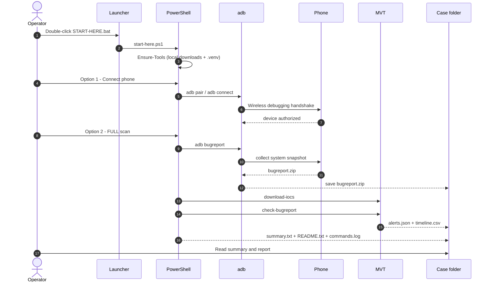
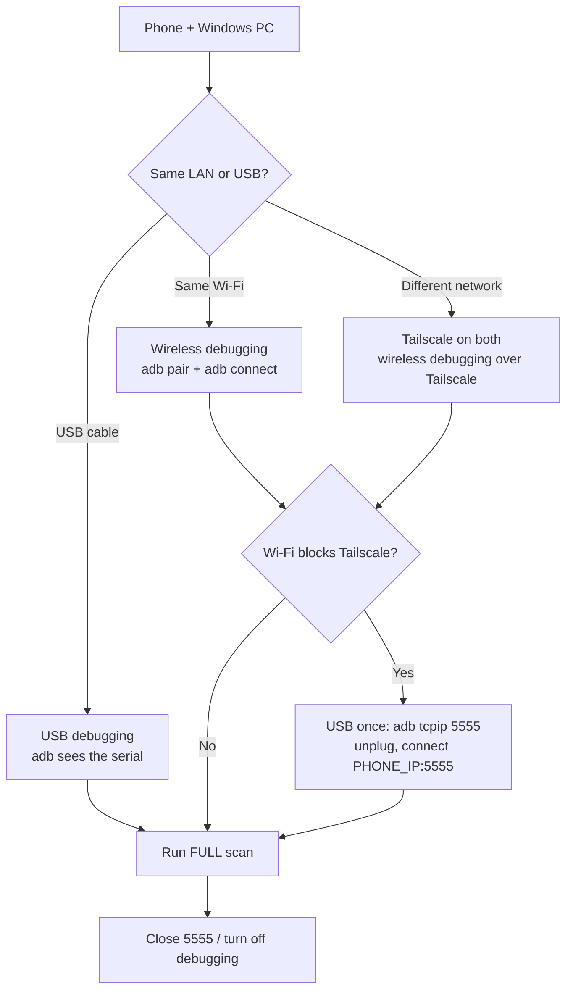

# Architecture and operator guide

This is the system map for the Android Security Triage toolkit: what runs where,
which connection path is used, what each tool does, what gets collected, and how
to run the whole thing from a clean Windows PC.

> **Consent required.** Use this only on a phone you own or have explicit
> permission to examine. A clean result means no known indicators were found in
> the collected data, not mathematical proof that the phone is clean.

---

## 1. What the project is

A click-to-run Windows wrapper around open-source Android triage tools. It:

1. connects to an Android phone over **USB**, **same Wi-Fi**, or **Tailscale**;
2. collects a system snapshot with **ADB** (and optionally **androidqf**);
3. runs **MVT** against known spyware indicator lists;
4. pulls sideloaded APKs and hashes them;
5. runs **APKiD** or **MobSF** on the APKs when needed;
6. exports personal data on request (shared storage, logs, optional root app data);
7. writes everything into one timestamped case folder that stays local.

Nothing is installed on the phone. No root is required for the triage scan or the
normal export. The toolkit does not install apps or change app data; the optional
USB fallback temporarily switches ADB to TCP mode and is reversible. Root export
only reads `/data/data` when the phone is already rooted.

| Item | Value |
|---|---|
| Host | Windows 10/11, PowerShell 5.1+ |
| Target | Any Android phone with USB debugging / wireless debugging |
| Connection | USB, same Wi-Fi, Tailscale, or ADB TCP 5555 fallback |
| Scan modes | Quick, Full, Deep |
| Analysis | MVT, APKiD, MobSF (optional) |
| Export | Shared storage + logs (no root); app data (rooted phone) |
| Output | `cases\<timestamp>\` (gitignored) |
| Public report | `reports\` (redacted, safe to publish) |
| Not supported | iOS; app databases on a non-rooted phone; full forensic imaging |

---

## 2. Architecture at a glance



**Key point:** the phone only runs its normal ADB daemon. All processing happens
on the PC. `adb` is the only channel into the phone; every other tool works on
files that `adb` already copied into the case folder.

---

## 3. Data flow



---

## 4. Components

### 4.1 Launchers (double-click)

| File | What it does |
|---|---|
| `START-HERE.bat` | Opens the main menu: connect, scan, open results, repair tools, Tailscale help |
| `SETUP-TOOLS.bat` | Installs or repairs adb, androidqf, scrcpy, MVT and APKiD |
| `CONNECT-PHONE.bat` | Runs the connection flow only |
| `FULL-SCAN.bat` | Connects if needed, then runs collector + bugreport + MVT |
| `EXPORT-DATA.bat` | Exports personal data (shared storage, logs, optional root app data) |
| `REMOTE-SETUP.bat` | Opens the Tailscale remote-connection helper |
| `CONNECT-TCP-5555.bat` | Connects to the phone's TCP 5555 port after USB setup |
| `SWITCH-TAILSCALE-ACCOUNT.bat` | Signs the PC out of Tailscale and opens the login flow |

### 4.2 PowerShell engine

| File | Role |
|---|---|
| `start-here.ps1` | Setup, menu, Tailscale discovery, ADB pairing, scan launcher |
| `android-triage.ps1` | The collector: runs ADB commands, builds the case folder, pulls APKs, calls MVT |
| `export-data.ps1` | Shared-storage/log export with manifest; optional root app-data export |
| `connect-tcp-5555.ps1` | Finds the phone in Tailscale and runs `adb connect <ip>:5555` |
| `switch-tailscale-account.ps1` | Switches the PC to a different Tailscale account |

### 4.3 Local tools

Everything is installed under this folder. Nothing is installed system-wide and
no admin rights are required.

| Tool | Location | Purpose | When used |
|---|---|---|---|
| Android platform-tools (`adb`) | `tools\platform-tools` | Transport and collection | Every scan |
| **MVT** | `.venv\Scripts\mvt-android.exe` | Compares bugreport/androidqf data against known spyware indicators | Full and Deep |
| **androidqf** | `tools\androidqf` | Interactive deep acquisition (extra system artifacts) | Deep only |
| **APKiD** | `.venv\Scripts\apkid.exe` | Detects packers, protectors, compilers in APKs | Manual command |
| **androguard** | not auto-installed | Manifest/permission inspection | Manual, optional |
| **scrcpy** | `tools\scrcpy` | Live phone screen and control | Menu option 6 |
| **MobSF** | Docker image | Full APK security report | Menu option 7, optional |
| **wa-crypt-tools** | `.venv` (manual install) | Decrypts WhatsApp `.crypt14`/`.crypt15` backups | Export follow-up, optional |
| **Tailscale** | system install | Private network path to a remote phone | Remote scans |
| Python + venv | `.venv` | Runs MVT and APKiD | Setup |

The setup downloads adb, androidqf and scrcpy, creates `.venv`, and installs the
versions pinned in `requirements.txt` (`mvt`, `apkid`). `androguard` and MobSF
are optional/manual and are not part of the automatic scan.

Shizuku is **not** bundled. It is mentioned in the FAQ only as an example of a
shell-level tool: it runs with the same ADB permissions and cannot read app
sandboxes either.

### 4.4 Case folder

Each scan creates `cases\<timestamp>\`:

```text
cases\2026-11-11_224124\
  summary.txt                 parsed flags + device overview
  packages_thirdparty.txt     third-party apps, installer, APK path
  accessibility.txt           enabled accessibility services
  settings_secure.txt         accessibility / notification listeners
  settings_global.txt         VPN, Private DNS, developer options, ADB
  device_policy.txt           active device administrators
  accounts.txt                accounts registered on the device
  processes.txt               running processes
  logcat_tail.txt             last 5000 log lines
  dumpsys_package.txt         full package metadata
  network.txt                 dumpsys connectivity
  bugreport.zip               system snapshot (Full scan)
  bugreport_run.log           bugreport collection log
  mvt_results_bugreport\      MVT alerts, timeline, parsed dumpsys
  androidqf\                  androidqf acquisition (Deep scan)
  androidqf_run.log           androidqf console log
  mvt_results_androidqf\      MVT results from the androidqf archive
  apks\                       pulled APKs
  apk_hashes.txt              SHA-256 of each pulled APK
  commands.log                exact commands executed
  README.txt                  next steps
```

`cases\` is gitignored. It is not published to GitHub.

A data export creates a separate `cases\export_<timestamp>\`:

```text
cases\export_2026-11-11_230000\
  shared\                     photos, downloads, WhatsApp/Telegram media
  logs\                       logcat, dumpsys, content queries, optional bugreport
  appdata\                    root only: /data/data package tars, extracted
  manifest.csv                path, size and SHA-256
  EXPORT-README.txt           what was exported and what is still missing
  commands.log                exact commands executed
  pull.log                    adb pull output
```

See section 14 and `DATA-EXTRACTION.md` for the full extraction matrix.

---

## 5. Connection paths



| Path | Phone setup | PC action | Best for |
|---|---|---|---|
| **USB** | USB debugging ON, authorize the PC | `adb devices`; menu detects the serial | Local, fastest, most reliable |
| **Same Wi-Fi** | Wireless debugging ON, pair with code | `adb pair` + `adb connect` to LAN IP | Phone and PC on the same network |
| **Tailscale** | Wireless debugging ON + Tailscale connected | `adb pair` + `adb connect` to Tailscale IP | Remote phone on another network |
| **USB → TCP 5555** | USB debugging ON once | `adb tcpip 5555`, then `adb connect IP:5555` | Wi-Fi blocks Tailscale |

### Path A - USB

1. On the phone: Developer options → USB debugging ON.
2. Connect a **data** USB cable.
3. Tap **Allow** on the "Allow USB debugging?" prompt.
4. Run `START-HERE.bat`. The menu shows the device serial.

### Path B - same Wi-Fi

1. Phone: Developer options → Wireless debugging ON.
2. Tap **Pair device with pairing code**.
3. Run `CONNECT-PHONE.bat` → choose **2) Same Wi-Fi / USB cable**.
4. Enter the pairing IP:port and the 6-digit code.
5. Enter the **connect** port from the Wireless debugging screen (not the pairing port).

### Path C - Tailscale (recommended for remote)

Two ways to share the phone:

- **Invite:** invite the owner's email to your tailnet; the phone appears directly.
- **Share:** the owner keeps their own tailnet and shares only the phone with your
  Tailscale account. More private.

Then:

1. Phone: install Tailscale, sign in, turn the VPN ON.
2. Phone: Wireless debugging ON.
3. Run `REMOTE-SETUP.bat` or `START-HERE.bat` → **1**.
4. Pick the Android peer. The script already knows its Tailscale IP.
5. Enter the **pairing port** and the 6-digit code.
6. Enter the **connect port** from the Wireless debugging screen.

Keep the phone unlocked, charging, and Tailscale connected during the scan.

### Path D - USB → TCP 5555 fallback

Use this when Android's Wireless debugging forces Wi-Fi and that Wi-Fi breaks
Tailscale.

1. On a Windows PC connected to the phone by USB, run
   `ADB-TCPIP-HELPER.zip` → `ENABLE-ADB-TCPIP.bat`.
   This runs `adb tcpip 5555` once.
2. Unplug USB. The phone can stay on mobile data; Tailscale stays online.
3. On the operator PC, run `CONNECT-TCP-5555.bat`.
4. Run the FULL scan.
5. Cleanup: reconnect USB and run `DISABLE-ADB-TCPIP.bat`, or restart the phone.

Port 5555 is reachable on the phone's network interfaces while TCP mode is on.
Use it only on a trusted or Tailscale network, never port-forward it on a router,
and close it after the scan.

---

## 6. Scan modes

| Mode | Menu | What it runs | Time |
|---|---|---|---|
| **Quick** | 3 | Collector + APK pull | A few minutes |
| **Full** | 2 | Collector + `adb bugreport` + MVT `check-bugreport` | 5-15+ min over remote |
| **Deep** | 4 | androidqf interactive acquisition + MVT `check-androidqf` | Longest |

- **Quick** is for a fast look at packages, permissions, accessibility, admins,
  settings, accounts, processes and logcat.
- **Full** is the recommended scan. It adds a full system snapshot and the MVT
  known-indicator analysis.
- **Deep** is optional. androidqf 1.8.3 asks questions in the console and
  collects extra artifacts. Use it only when you need more than the bugreport.

The FULL scan does **not** run androidqf. That is intentional: androidqf is
interactive, while the bugreport path is automatic and works well remotely.

---

## 7. What gets collected

Collected with ADB:

- build properties, model, Android version, patch level;
- verified boot, bootloader lock, `ro.debuggable`, `ro.secure`, SELinux, mounts;
- installed packages, versions, installers, first-install/update times;
- permissions and app-ops (which app used which permission and when);
- accessibility services and notification listeners;
- device administrators, VPN, Private DNS, developer options, ADB state;
- Android users/profiles and accounts (names/types; Android may mask account names);
- running processes, services, bounded logcat;
- network state (`dumpsys connectivity`);
- `adb bugreport` (Full);
- pulled APKs and SHA-256 hashes;
- MVT alerts, timeline and parsed `dumpsys` snapshots.

**Not readable without root / not collected by this toolkit:**

- `/data/data/<app>` sandboxes;
- Chrome `History`, cookies, logins;
- WhatsApp `msgstore.db` and the chat database (WhatsApp media in shared
  storage can be pulled with ADB);
- SMS/MMS, call log and contacts databases;
- app-private files, saved passwords, OAuth tokens, Keystore, clipboard.

Accessible via ADB without root but outside the automatic scan: photos/DCIM,
Downloads and WhatsApp media in shared storage (`adb pull`).

A non-root ADB shell cannot read app-private directories, and `run-as` only works
for debuggable apps. Since Android 12, `adb backup` also excludes app data for
apps targeting API 31+. Both Chrome and WhatsApp target API 36 on current
phones, so `adb backup` is not a way around this. Tools such as MVT, androidqf,
Shizuku and MobSF run at the same shell level or only inspect APKs; they cannot
bypass the sandbox. Root, an unlocked bootloader, or a commercial forensic
exploit would be required, and unlocking the bootloader wipes the phone.

See `reports\2026-11-11-redmi-12-5g.md` section 6 for the exact data-scope note.

For extracting the actual content (WhatsApp media and backups, Telegram files,
photos, logs), use `EXPORT-DATA.bat`; see section 14 and `DATA-EXTRACTION.md`.
The triage scan and the data export are separate on purpose: scanning is
read-only and small, exporting copies personal content.

---

## 8. Step-by-step: from zero to a report

### Before you start

- Windows 10/11 PC.
- PowerShell 5.1 (built in).
- Python 3.11+ (`python` or `py -3`).
- Phone owner's consent.
- Optional: Tailscale on PC and phone for a remote scan.

### First run

1. Download or clone this repository.
2. Double-click **`START-HERE.bat`**.
3. The first run downloads platform-tools, androidqf and scrcpy, creates
   `.venv`, and installs MVT + APKiD. This can take a few minutes.
4. Choose **8) Check / repair tools** if anything failed.

### Connect

- Local: USB, or same Wi-Fi with Wireless debugging.
- Remote: Tailscale, then `START-HERE.bat` → **1**.

### Scan

1. Choose **2) FULL scan**.
2. Keep the phone unlocked and charging. Do not disconnect Tailscale.
3. Wait for the case folder and `summary.txt`.
4. Open the newest folder under `cases\`.

### Read

- `summary.txt` — parsed flags and device overview.
- `mvt_results_bugreport\alerts.json` — MVT findings.
- `apk_hashes.txt` — SHA-256 of pulled APKs.
- `READING-THE-RESULTS.txt` — how to interpret the flags and MVT levels.
- `reports\2026-11-11-redmi-12-5g.md` — a redacted example.

### Optional follow-up

- **Export personal data:** run `EXPORT-DATA.bat` (menu **12**). See section 14.
- **Deep acquisition:** menu **4**.
- **Live screen:** menu **6** (scrcpy).
- **MobSF:** menu **7** (Docker Desktop required).
- **APKiD manually:**
  ```powershell
  Get-ChildItem .\cases\<case>\apks\*.apk | ForEach-Object {
      .\.venv\Scripts\apkid.exe $_.FullName
  }
  ```
- **androguard manually:** install it in the venv if needed, then inspect the
  APK manifest and permissions.

### Cleanup

1. Turn off Developer options and USB debugging.
2. If TCP 5555 was used, run `DISABLE-ADB-TCPIP.bat` or restart the phone.
3. Remove the Tailscale share if the phone was shared temporarily.
4. Keep the case folder secure; delete it when no longer needed.

---

## 9. Troubleshooting

| Symptom | Fix |
|---|---|
| `adb` not found | Run `START-HERE.bat` once, or `SETUP-TOOLS.bat` |
| No device listed | Use a data cable, unlock the phone, tap Allow, run `adb kill-server` then `adb devices` |
| `unauthorized` | Tap Allow on the phone; if needed, revoke USB debugging authorizations and reconnect |
| Pairing fails | Codes expire; reopen "Pair device with pairing code" and use the new port/code |
| Wrong port | The pairing port and connect port are different; read both from the phone |
| Tailscale peer offline | Open Tailscale on the phone and confirm it says Connected |
| `adb connect` refused | TCP mode is off, the phone rebooted, or the wrong IP/port was used; rerun the helper |
| Bugreport is slow | Normal over remote; keep the phone awake and use USB if possible |
| MVT fails | Check internet access for `download-iocs`; rerun `mvt-android download-iocs` |
| MobSF fails | Start Docker Desktop; MobSF is optional |
| Python missing | Install Python 3.11+ from python.org, then rerun setup |
| Case folder empty | The scan aborted; read the console output and `commands.log` |

---

## 10. Security and limits

- Use only with consent.
- A non-rooted phone cannot be fully imaged. This is a triage snapshot, not a
  forensic image.
- `adb tcpip 5555` opens a port on the phone while TCP mode is enabled. Use it
  only on a trusted or Tailscale network, never port-forward it, and close it
  after the scan.
- Case folders contain personal data: package lists, account names/types,
  settings, logs and a system snapshot. Keep them local and gitignored.
- If the repo is inside OneDrive, OneDrive may sync the case folder. Move the
  case outside OneDrive or pause sync if that matters.
- Do not post pairing ports or codes in a group chat.
- A clean result means no known indicators were found, not proof of cleanliness.
- If malware is suspected, preserve the case folder before resetting the phone,
  change passwords from a clean device, and enable 2FA.

---

## 11. Repository map

| Path | Purpose |
|---|---|
| `START-HERE.bat` | Main menu |
| `FULL-SCAN.bat` | One-click full scan |
| `EXPORT-DATA.bat` | Personal data export |
| `CONNECT-PHONE.bat` | Connection flow |
| `CONNECT-TCP-5555.bat` | ADB TCP fallback |
| `REMOTE-SETUP.bat` | Tailscale remote helper |
| `SETUP-TOOLS.bat` | Install/repair tools |
| `SWITCH-TAILSCALE-ACCOUNT.bat` | Tailscale account switch |
| `start-here.ps1` | Menu, setup, connection, scan launcher |
| `android-triage.ps1` | Collector and case-folder builder |
| `export-data.ps1` | Shared-storage/log/root app-data export |
| `connect-tcp-5555.ps1` | TCP 5555 connector |
| `switch-tailscale-account.ps1` | Tailscale sign-out/login |
| `requirements.txt` | Pinned MVT and APKiD versions |
| `READING-THE-RESULTS.txt` | Flag and MVT severity guide |
| `HOW-TO-USE.txt` | Short operator reference |
| `END-TO-END-GUIDE.md` | Detailed operator runbook |
| `DATA-EXTRACTION.md` | Extraction matrix, app exports, root and forensic options |
| `FOR-PHONE-OWNER.txt` | Phone-side instructions |
| `ADB-TCPIP-HELPER.zip` | Ready-to-run ADB + enable/disable scripts |
| `reports\` | Redacted public scan summaries |
| `cases\` | Local evidence (gitignored) |
| `tools\` | Local binaries (gitignored) |
| `.venv\` | Local Python environment (gitignored) |

---

## 12. Current status

| Area | Status |
|---|---|
| One-click setup | Working |
| USB connection | Working |
| Same-Wi-Fi wireless debugging | Working |
| Tailscale wireless debugging | Working |
| USB → TCP 5555 fallback | Working |
| Quick scan | Working |
| Full scan (bugreport + MVT) | Working |
| Deep androidqf scan | Working, interactive |
| APK pull + SHA-256 | Working |
| MVT known-indicator scan | Working |
| APKiD | Installed; run manually |
| scrcpy live screen | Working |
| MobSF | Optional; needs Docker Desktop |
| Personal data export (shared storage, media, logs) | Working |
| Root app-data export (`-Root`) | Requires a rooted phone |
| Chrome cookies / saved passwords | Encrypted; Frida or forensic tool |
| Redacted public report | Included |
| App databases on a non-rooted phone | Out of scope (sandbox) |
| App databases on a rooted phone | Supported by `export-data.ps1 -Root` |
| iOS support | Out of scope |

---

## 13. FAQ: can this extract Chrome or WhatsApp databases?

**No, not the live databases, with USB debugging alone.**

- Chrome's `History` and WhatsApp's `msgstore.db` live in `/data/data/<app>/`.
  The ADB shell user cannot read those directories; SELinux blocks it.
- `run-as` only works for debuggable apps. Chrome and WhatsApp are release builds.
- `adb backup` excludes app data for apps targeting Android 12 (API 31) or higher.
  Both apps target API 36 on current phones.
- MVT, androidqf, Shizuku, MobSF and ALEAPP cannot bypass the sandbox.

The toolkit's `export-data.ps1` does not change that. It copies shared storage
and runs app-level exports; with `-Root` it reads `/data/data` only when the
phone is already rooted.

What *is* possible without root:

- pull shared storage such as `DCIM`, Downloads and WhatsApp media;
- copy WhatsApp's **encrypted** local backups from
  `/sdcard/Android/media/com.whatsapp/WhatsApp/Databases/` (ciphertext, not messages);
- export individual WhatsApp chats from inside the app as plain text;
- use Google Takeout / Chrome sync for Chrome history;
- read recent URLs from the `dumpsys activity` recents dump (metadata only).

A tool that claims to read these databases over plain ADB is using an exploit,
requires root, or is fake. Treat it with suspicion.

---

## 14. Personal data export

`EXPORT-DATA.bat` (menu **12**) is the content-export side of the toolkit. It is
separate from the triage scan: the scan looks for indicators, the export copies
the actual data. Full details, app-by-app steps and the root procedure are in
[`DATA-EXTRACTION.md`](DATA-EXTRACTION.md).

### 14.1 No-root export

| Category | What it copies |
|---|---|
| `whatsapp-media` | `/sdcard/Android/media/com.whatsapp/WhatsApp/Media` |
| `whatsapp-backups` | latest 2 `msgstore*.db.crypt14` files (ciphertext) |
| `telegram` | both Telegram media roots in shared storage |
| `dcim`, `pictures`, `movies` | photos and videos |
| `downloads`, `documents`, `recordings` | user files and call recordings |
| `logs` | logcat, notifications, usage stats, accounts, Wi-Fi, recents, settings |
| `logs\content\` | `content query` attempt for SMS, call log, contacts |
| `-WithBugreport` | full `adb bugreport` ZIP |
| `manifest.csv` | path, size and SHA-256 of every file |

```powershell
.\export-data.ps1 -Preset all -WithBugreport
.\export-data.ps1 -Preset whatsapp
.\export-data.ps1 -Preset all -ListOnly       # size preview only
```

It does not install anything and does not print file contents to the console.
The case folder is `cases\export_<timestamp>\` and is gitignored.

### 14.2 Root export

```powershell
.\export-data.ps1 -Root -Yes
```

Requires a working `su`. It force-stops WhatsApp, Chrome and Telegram, tars each
package from `/data/data` to `/data/local/tmp`, pulls the tar, deletes the
temporary file, extracts it under `appdata\`, and writes `appdata_hashes.txt`.

Default packages:

```text
com.whatsapp
com.android.chrome
org.telegram.messenger
com.android.providers.telephony
com.android.providers.contacts
```

What root gives you: WhatsApp `msgstore.db`, `wa.db` and the `key` file; Chrome
`History`, `Cookies` and `Login Data`; Telegram `cache4.db`; the SMS database;
the contacts/call-log database. Chrome cookies and passwords are still encrypted
with Android Keystore; pulling the file is not the same as reading it.

Root costs: unlocking the bootloader **wipes the phone**, trips Play Integrity,
may break banking/wallet/DRM apps, and a bad flash can brick it. Export shared
storage and run the app exports first.

### 14.3 What still needs an app export or a lab

| Data | Route |
|---|---|
| WhatsApp messages | In-app **Export chat**, or root + SQLite |
| WhatsApp cloud backup | 64-digit key + `wa-crypt-tools wadecrypt` |
| Telegram messages | **Export Telegram data** (JSON/HTML), or root |
| Chrome history | Google Takeout, or root |
| Chrome cookies / passwords | Frida/Keystore or a commercial forensic tool |
| SMS / call log | Exporter app, or root |
| Contacts | Contacts app → export `.vcf`, or root |
| Wi-Fi passwords, Keystore, tokens | Root where possible; some are non-exportable |

For a legally defensible extraction from a locked phone, use a forensic lab with
Cellebrite, Oxygen, Magnet AXIOM or MSAB XRY. No free script can replace that.
